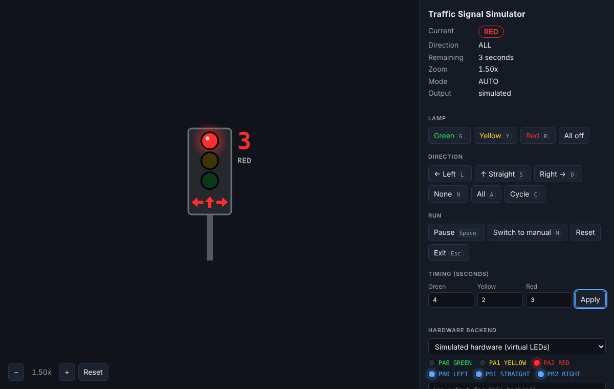
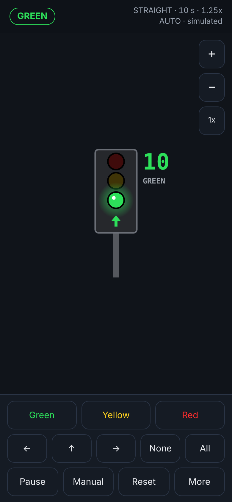
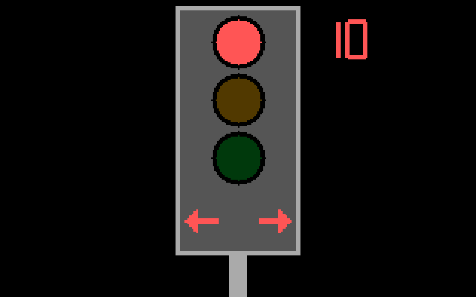

# Traffic Signal Control System

A modular evolution of an 8086 + 8255 DOSBox traffic-signal program into a portable
design: one state machine, many interchangeable displays and hardware backends.

> **Educational project.** Not safe, tested or certified for public-road traffic
> control. See `docs/hardware.md`.

| Desktop simulator | Mobile PWA | DOS / 8086 (mode 13H, zoom 1.5x) |
|---|---|---|
|  |  |  |

## 1. Objective
Keep the original behaviour (8255 on 80H-86H, G 10 s -> Y 3 s -> R 10 s), but separate
**traffic logic**, **rendering**, **hardware**, **input** and **configuration** so each can be replaced.

## 2. Existing system
`legacy/original_traffic.asm` (preserved, unmodified; assembles as-is). It is a DOS
application issuing `OUT` to the 8255 directly - not an OS-independent driver - so the
binary itself cannot run on Android/Windows/Linux. The *logic* is what is made portable.
Details and limitations: `docs/architecture.md`.

## 3. New features
Circular lamps (dim when off) - zoom 0.5x-3.0x (DOS 0.5x-1.5x) - arrows for
NONE/LEFT/STRAIGHT/RIGHT and combinations - configurable timing - AUTO/MANUAL, pause,
reset - countdown - input validation - simulated-hardware fallback - 8255, serial/MCU,
virtual-LED backends - desktop simulator - mobile PWA + native C API.

## 4. Architecture
```
              TRAFFIC CORE (state machine + config)
                          |
                    TrafficState (read-only snapshot)
              +-----------+-------------+
        HardwareInterface            Renderer
   8255 | serial/MCU | simulated | callback      DOS | canvas | SVG
```
Full diagram, module table, preserved/refactored/added list: `docs/architecture.md`.

## 5. State machine
GREEN -> YELLOW -> RED -> GREEN on timer expiry; manual `setState` restarts a phase;
`allOff` -> OFF. Direction is independent of colour. `docs/state-machine.md`.

## 6. 8255 interface
A=80H (PA0 G, PA1 Y, PA2 R), B=82H (PB0/1/2 left/straight/right), C=84H, control=86H=`80H`.
Only `platform/dos/hw/hw8255.inc` / `hardware/i8255_backend.*` know these. `docs/8255.md`.

## 7. Hardware abstraction
`HardwareInterface { initialize, isAvailable, applyState, allOff }`. The engine calls it
after every change; `selectHardware(preferred, fallback)` drops to simulation when the
preferred device is unavailable.

## 8. Graphics renderer
`Renderer` primitives: circle, rectangle, line, polygon, text, arrow. `TrafficLightView`
(`drawTrafficLight/Housing/Lamp/Pole/DirectionArrow/Countdown`) turns a state into
primitives and never computes time. Implementations: SVG (C++), canvas (JS), mode-13H (asm).

## 9. Zoom
Logical coordinates + one transform: `screen = origin + logical * scale`, radius scaled
the same way. Housing, lamps, pole, arrows, text, countdown all scale. Limits 0.5..3.0
(DOS 0.5..1.5, 8.8 fixed point). Keys `+ =`/`-`, `0` resets (**R is RED**, so reset-zoom
is `0`); desktop also has mouse wheel and +/- buttons.

## 10. Directions
3-bit mask beside the colour (`GREEN + LEFT` = two fields). Renderers draw polygons;
8255 writes the mask to Port B; serial sends it. `docs/architecture.md` section 6.

## 11. Run in DOSBox
Needs an assembler inside DOSBox (MASM 6.x or TASM) - not bundled.
```
mount c C:\path\to\traffic-signal\platform\dos
c:
build.bat            (or build_tasm.bat)
traffic              (default 10/3/10)
traffic 15 4 12      (green yellow red, 1..99)
```
Keys: `G Y R` lamp - `L S D` left/straight/right - `N` none - `A` all - `C` cycle -
`+ -` zoom - `0` reset zoom - `SPACE` pause - `M` auto/manual - `ESC` exit (lamps off).
Cross-assemble on Linux/macOS: `cd platform/dos && ./build_uasm.sh`.
VGA mode 13H is required (DOSBox default is fine).

## 12. Run with hardware
* **8255 board:** run `traffic.exe` on DOS (or DOSBox with the board's I/O passed through);
  the program reads back Port A to detect the chip and shows `OUT: 8255` or `SCREEN ONLY`.
* **Microcontroller:** flash `hardware/arduino/traffic_signal.ino`, use `SerialBackend`
  (`hardware/serial_backend.hpp`). Wiring and safety notes: `docs/hardware.md`.

## 12b. Guard + Controller apps (live, networked; Docker: `docker compose up --build`)
See `docs/network.md`: `start.bat` / `./start.sh`, then open `/controller/` and `/guard/`.

## 13. Desktop and mobile
```
cd platform && python3 -m http.server 8000     # serves desktop/ and mobile/ (mobile reuses desktop/js)
```
Open `http://localhost:8000/desktop/` or `/mobile/` (the PWA installs to a phone's home
screen and works offline). Native apps: `platform/mobile/traffic_c_api.h` +
`android/` (JNI + Kotlin wrapper + CMake). Architecture: `docs/portability.md`.

## 14. Tests
```
./run_all_tests.sh        # runs what your machine supports
make test                 # C++ engine/8255/serial/zoom/config (104) + C API (17)
node tests/test_core.js   # JS engine (98)
sh tests/cross_check.sh   # C++ vs JS traces must be identical
python3 tests/browser_test.py                 # needs playwright
python3 tests/dos_emulation_test.py traffic.exe   # needs unicorn, pillow
```
Core tests use no graphics and no hardware. The DOS test executes the real assembled
machine code in a CPU emulator with BIOS/DOS and the 8255 stubbed and checks exact port
bytes, 10/3/10 timing, keys, command-line parsing and rendered pixels.

Other commands: `make demo` (prints the port writes), `make frames` (SVG frames).
Example configs: `examples/default.cfg`, `examples/fast_test.cfg`.

## 15. Limitations and verified status
* **Verified here:** C++/JS/C tests; JS and C++ identical traces; desktop and mobile pages
  in headless Chromium; DOS program assembled with UASM and executed in a CPU emulator.
* **Not verified here:** a run in real DOSBox, the MASM/TASM batch files (only UASM was
  used), real 8255 hardware, the Arduino sketch on a board, the Android build.
* DOS screen text uses the BIOS font (not scaled); the countdown digits are scaled.
* DOS zoom max is 1.5x (200-pixel screen). DOS durations are 1..99 s; others 1..3600 s.
* `DevPortIO` on a normal PC touches POST/DMA ports - only use with a real 8255 at those addresses.

## 16. Future improvements
Conflict-monitored multi-approach junction (several engines + interlock), pedestrian
phase, flashing-yellow/night mode, Bluetooth LED backend, native iOS wrapper, SDL
desktop frontend sharing the C++ view, persistent config UI.

## Layout
```
core/  hardware/  rendering/  platform/{dos,desktop,mobile}/  tests/  examples/  docs/  legacy/
```
